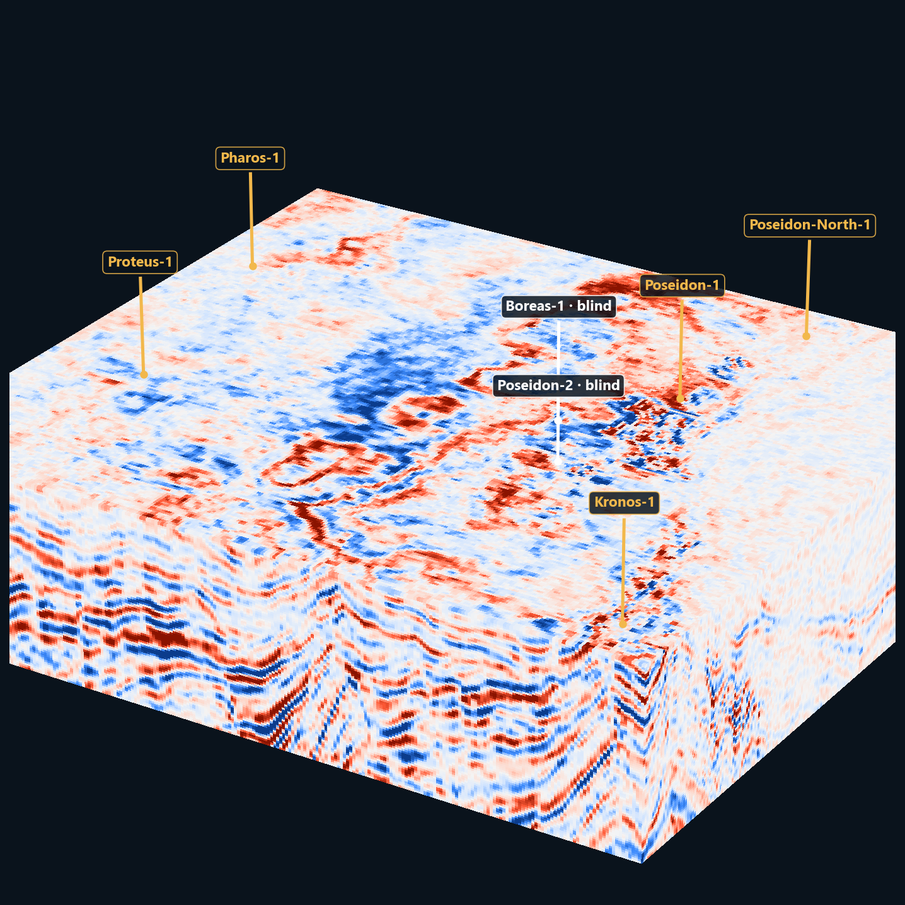
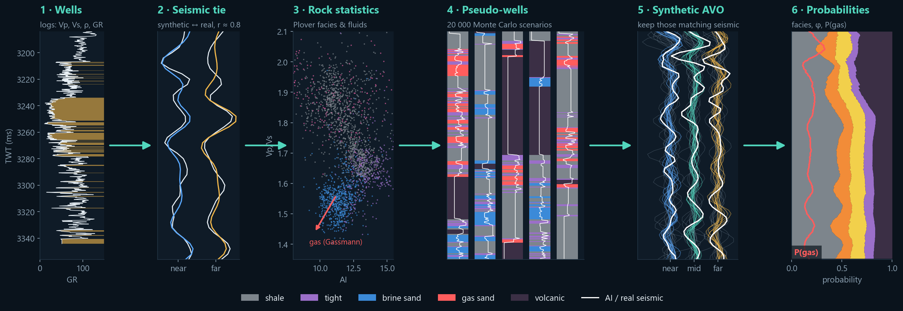
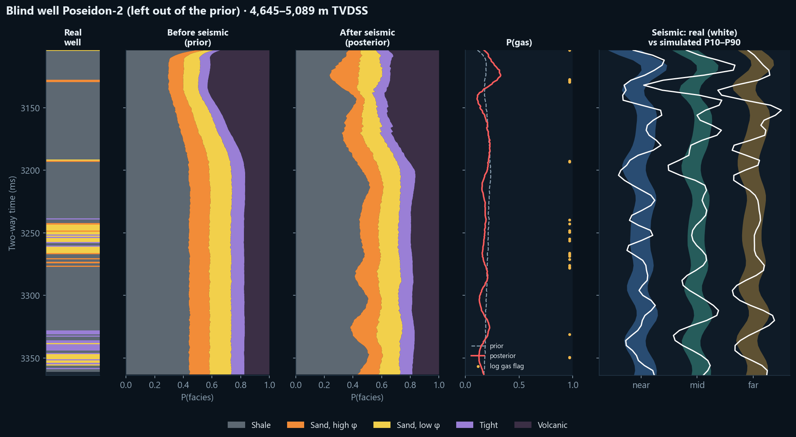
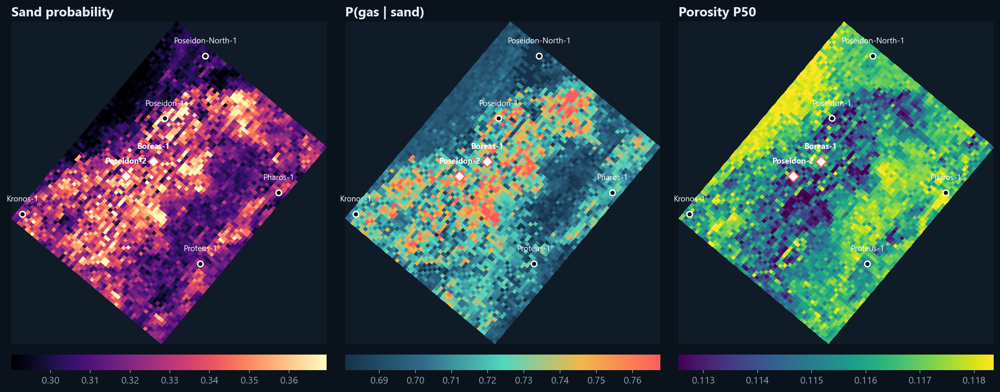

# force-hackathon

## Poseidon: pseudo-wells that listen to the seismic

**[▶ Open the interactive presentation](https://alexandrepimont.github.io/force-hackathon/presentation_short/)** (GitHub Pages) · backup link: [raw.githack](https://raw.githack.com/alexandrepimont/force-hackathon/main/docs/presentation_short/index.html) · the whole deck is also shown below



### 1 · Workflow: from wells to probabilities in six steps

Tie the wells → learn the Plover rock → simulate 20 000 pseudo-wells → model near/mid/far → weigh them against the
real seismic → repeat at 4 275 traces for 3D.



### 2 · Results: blind well Poseidon-2 (simulated)



| Facies | Porosity | Seismic |
|---|---|---|
| **94 %** of samples get the right facies class (68 % at Boreas-1) | **86 %** of the real porosity lies inside P10–P90 (95 % at Boreas-1) | **r ≈ 0.74** between simulated and real near/mid/far traces |

### 3 · Results: 3D on a 300 m grid (simulated)



| Sand | Gas | Trust |
|---|---|---|
| SW–NE corridor through Poseidon-2 and Boreas-1: P(sand) 0.35–0.37 vs 0.29 at the edges | P(gas \| sand) is highest in the same corridor (0.76 vs 0.69) | Median seismic fit 0.78; about a quarter of the traces are weakly supported |

Pseudo-wells and maps are simulated, not measured data. Data: Poseidon 3D seismic (TGS, CC BY 4.0) and Geoscience
Australia well data (CC BY 3.0 AU).

## Dashboard

Run the local explorer on the real Poseidon wells:

```powershell
.\.venv\Scripts\python.exe -m pip install -r requirements.txt
.\.venv\Scripts\python.exe scripts\download_poseidon_wells.py
.\.venv\Scripts\python.exe scripts\prepare_poseidon_dashboard.py
.\.venv\Scripts\streamlit.exe run dashboard\app.py
```

`prepare_poseidon_dashboard.py` combines the 8 wells into `data\poseidon\dashboard\` (log table with
standard curve names, Vp, Vs, acoustic impedance, Vp/Vs, TVDSS and formation per sample, plus tops, well
locations and a provenance manifest). If the near/mid/far SEG-Y stacks are downloaded, it also builds a fast
display cache in `data\poseidon\seismic\cache\` (~3 GB per stack, about 1 minute each). The dashboard opens
the Poseidon folder by default and shows log tracks with formation tops, a well map with a tops correlation,
AI vs Vp/Vs crossplots, and a **Seismic** tab with inlines, crosslines and time slices of the near, mid and far
stacks (side by side on one colour scale), wells overlaid, and near/mid/far traces at the selected well.

To view the synthetic test data instead, enter `data\synthetic_reservoir` as the data folder in the sidebar.
The synthetic data is for software testing and is not representative of field measurements.

## Poseidon well data

Download the Poseidon 3D well data into `data\poseidon\wells\` (git-ignored):

```powershell
.\.venv\Scripts\python.exe scripts\download_poseidon_wells.py          # logs, headers, tops
.\.venv\Scripts\python.exe scripts\download_poseidon_wells.py --drive  # + checkshot reports, surveys, well reports
```

| Folder | Content |
|---|---|
| `logs\<well>\` | Spliced composite LAS for Boreas-1, Kronos-1, Pharos-1, Poseidon-1, Poseidon-2, Poseidon-North-1, Proteus-1, Torosa-1 |
| `logs_extra\<well>\` | VSP-calibrated depth logs (Kronos-1, Pharos-1, Proteus-1 ST2), Poseidon-1/-2 CSV logs, Torosa-3 logs, deviation, VSP and markers |
| `ga\` | Geoscience Australia borehole headers and lithostratigraphy intervals |
| `tops\well_tops.csv` | Combined formation tops (MD below rig datum) with source per pick |

All data is Geoscience Australia open-file data (CC BY 3.0 AU; authoritative source:
[NOPIMS](https://public.neats.nopta.gov.au/nopims)). The script pulls it from public GitHub mirrors and the
GA Boreholes WFS; `--drive` adds files from ConocoPhillips' Google Drive share, which is often blocked by
Google's "Quota exceeded" limit. The script is resumable, so rerun it to fill gaps.

## Poseidon seismic (near, mid, far stacks)

The full angle stacks are ~104 GB each, so this downloads a sub-volume from the public TGS MDIO copy on AWS
(`s3://tgs-opendata-poseidon`, CC BY 4.0) and writes SEG-Y to `data\poseidon\seismic\` (git-ignored):

```powershell
.\.venv\Scripts\python.exe scripts\download_poseidon_seismic.py
```

Default window: inlines 2310–3625, crosslines 1292–2769 (the 7 Poseidon-area wells plus ~100 traces) and
2560–4092 ms TWT (top Plover reservoir is ~3.1 s), about 3 GB per stack. Torosa-1 lies outside it; use
`--il`, `--xl`, `--t` and `--name` for other windows. Files use inline byte 189, crossline byte 193 and CDP X/Y
in GDA94 / MGA zone 51, so they load with `avo.segy_io.read_cube`.

## Well QC and automated well tie (agents 02 and 03)

```powershell
.\.venv\Scripts\python.exe scripts\run_well_qc.py     # task 02 -> data\interim\poseidon_logs\, outputs\well_qc\
.\.venv\Scripts\python.exe scripts\run_well_tie.py    # task 03 -> data\interim\poseidon_td\, data\processed\wavelets\,
                                                      #            configs\calibration.yaml, outputs\well_ties\, outputs\decision_log.md
```

- **QC** (`configs/petrophysics.yaml`): raw curves and provenance kept; bad-hole flags with the triggering rule;
  Vsh, porosity, Archie Sw and a lithotype scenario (shale, tight, low/high-porosity sand, volcanic, unknown).
  Fluid is not labelled from logs; only a gas indicator (low Sw + neutron-density crossover) is stored. TVDSS
  assumes vertical wells (no deviation surveys); the error estimate is in the summary.
- **Tie** (`configs/well_tie.yaml`, seismic facts in `configs/poseidon_seismic.yaml`): each well uses its own
  VSP-calibrated time-depth (Kronos-1, Pharos-1) or the nearest eligible well's; a bounded bulk shift and stretch is
  found automatically; Ricker wavelets and one global scale per stack come from training wells only (Poseidon-2
  and Boreas-1 held out). Polarity (reverse) and angle ranges (6-18, 18-30, 30-42 deg) are from the CGGVeritas
  processing report.
- **Dashboard:** step-by-step pages (1 Data, 2 Well logs, 3 Well QC, 4 Seismic, 5 Well tie, 6 Seismic through
  wells, 7 Rock physics, 8 AVO classification, 9 Prospect simulation) with back/next links. Step 5 shows per well
  what the automated tie changed and a line through the well with the tie on/off; every seismic view has a 2D map
  showing where the line is. The previous tabbed explorer is kept in `dashboard/legacy_explorer.py`.

## Prospect simulation: pseudo-wells in the reservoir zone (step 9 in the app)

```powershell
.\.venv\Scripts\python.exe scripts\run_prospect_sim.py --well Poseidon-2                          # blind test (Plover zone)
.\.venv\Scripts\python.exe scripts\run_prospect_sim.py --il 3180 --xl 2337 --t0 3120 --t1 3316    # any location
```

The prior is built **only from the Plover Formation** of the wells that have Plover tops
(`training.zone_formation_prefix` in `configs/prospect_sim.yaml`): Boreas-1, Kronos-1, Poseidon-1, Poseidon-2 and
Proteus-1. The former blind wells are included by team decision (`training.include_held_out_wells`), so there is no
independent blind test in the simulation; the well tie (wavelets, scales) still excludes them. Wells without tops
(Pharos-1, Poseidon-North-1) and Torosa-1 (outside the survey) are not used, neither for the prior nor for the
time-depth. A single overburden layer drawn from the logs just above Plover gives the top-reservoir contrast.

In step 9 of the app, build a section (inline, crossline or a composite line made by clicking points on the map;
clicks near a well snap to it),
mark the reservoir zone on it (pre-filled from the Plover top/base of the wells used; blind wells' tops are hidden)
and simulate one 1D pseudo-well at the chosen trace, scored inside the zone there. The section is only used to place
the point and the zone; nothing is simulated between wells in this step (see step 10 for 3D).
Thousands of pseudo-wells are simulated from the training wells (facies Markov chain and layer thicknesses,
correlated porosity / Vsh / Vp / Vs / density / GR per facies, gas or brine via Gassmann),
forward-modelled to near/mid/far with the tie wavelets and scales, and weighted against the observed traces at
the location. Output: facies probabilities, P10/P50/P90 logs, P(gas | sand) and the expected vs observed AVO
response (`outputs/simulation/<name>.npz/.json`; `<name>_blind.csv` with scores for wells). Settings and all
assumptions are in `configs/prospect_sim.yaml`; held-out wells are never used.

## 3D extrapolation of the pseudo-well simulation (step 10 in the app)

```powershell
.\.venv\Scripts\python.exe scripts\run_prospect_sim3d.py                                  # blind test + 300 m grid (~10 min)
.\.venv\Scripts\python.exe scripts\run_prospect_sim3d.py --blind-only                     # held-out wells only (~1 min)
.\.venv\Scripts\python.exe scripts\run_prospect_sim3d.py --il-step 32 --xl-step 48 --name quick   # 600 m grid
```

The same prior, forward model and localised weighting as step 9, on a decimated grid over the wells' area
(`src/avo/prospect_sim3d.py`, settings in `configs/prospect_sim3d.yaml`):

- The scored window follows top Plover, interpolated (plane fit) from the first Plover pick of the training wells
  with a tied time-depth curve (Kronos-1, Poseidon-1, Proteus-1).
- Pseudo-wells are simulated once per 50 m depth band (shared library) and re-weighted at every trace; traces are
  dithered between the two nearest bands so the prior changes smoothly with depth.
- Laterally consistent realizations (P-field): a spatially correlated uniform field picks a library member
  (ordered by porosity) from each trace's posterior, so facies, porosity and gas come from one consistent member.
- Output `outputs/simulation3d/<name>.npz/.json`: porosity P10/P50/P90, mean Vp/Vs/density/AI, facies
  probabilities, P(gas), seismic weight (support) and fit per trace, plus realizations. `<name>_blind.csv/.json`
  scores the same engine at Poseidon-2 and Boreas-1 (prior vs posterior) and compares the interpolated top with
  their own picks; their logs and tops are used for scoring only.
