# Seeing rock and fluid in seismic: an AVO workflow for the Poseidon field

*A practical textbook for junior geoscientists. FORCE Hackathon 2026.*

---

## How to use this book

This book explains **what we are trying to achieve, why, and how each step works**. It assumes you know basic
geology and have seen a seismic section and a well log, but not more. Every chapter starts with the key idea in
one sentence, then builds it up with figures. Equations are kept to the few you actually need.

Most figures use the **real Poseidon data** we downloaded (wells, tops and seismic). Concept figures use the same
physics code as our pipeline (`src/avo/`), so what you see here is what the software does. All figures can be
regenerated with:

```powershell
.\.venv\Scripts\python.exe scripts\make_textbook_figures.py
```

A glossary is at the end. Words in **bold** the first time they appear are in it.

---

## Chapter 1 – The goal in one picture

> **Key idea:** we want a 3D map of *what rock* and *what fluid* is in the reservoir, with an honest measure of
> how sure we are, using seismic data calibrated to seven wells.

Wells tell us exactly what is in the ground, but only along a thin line. Seismic covers the whole area but only
measures *echoes*. Our job is to learn the link between the two at the wells, and then use the seismic to predict
what is between and beyond the wells.

The end product is a set of **probability cubes**: for every point in the reservoir zone we estimate

- the **lithotype** (rock type): shale, tight/cemented sand, porous sand (and, if the data allow, low- vs
  high-porosity sand);
- the **fluid** in the sand: brine (salt water) or hydrocarbon (gas in Poseidon);
- the **uncertainty**: how spread out those probabilities are, and where the prediction should not be trusted.

We do not want a single "best guess" map. Two different rocks can produce almost the same seismic echo, so a
single answer would hide real risk. Instead we run *many* plausible geological scenarios and report
probabilities.

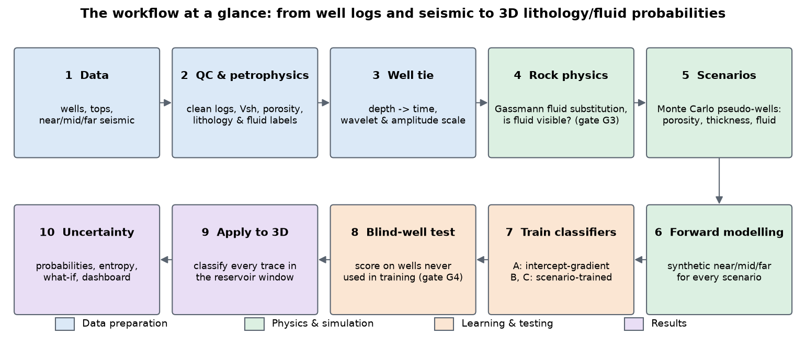

*Figure 1. The ten steps of the workflow. Blue: preparing data. Green: physics and simulation. Orange: learning
and honest testing. Purple: results.*

What the result looks like (from our synthetic test case, where the true answer is known):

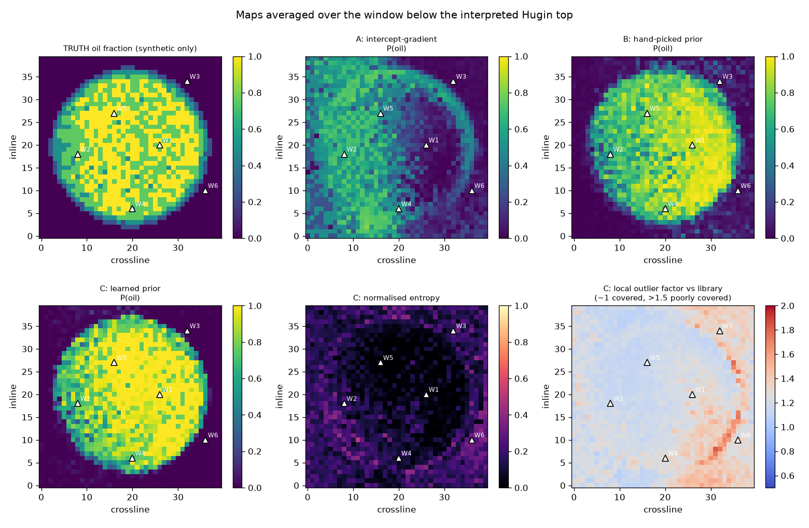

*Figure 2. Example output from the synthetic concept test. Top left is the "truth" (only known because the
earth was simulated). The other panels show predicted oil probability from three methods (A, B, C), the
uncertainty (entropy) and a map of where the seismic looks unlike anything the model was trained on. For Poseidon
the same products will be made for gas.*

---

## Chapter 2 – The Poseidon field and our data

> **Key idea:** seven wells with good logs sit inside a 3D seismic survey that has near, mid and far angle
> stacks; that combination is what makes this workflow possible.

### 2.1 Where we are

Poseidon is a gas field in the **Browse Basin**, offshore north-west Australia, discovered by ConocoPhillips with
Poseidon-1 in 2009. The reservoir is the Jurassic **Plover Formation** (sandstones, with volcanics near the top), at
roughly 4.2–5.0 km below sea level. It is sealed by the claystones of the Montara and Jamieson formations above.
All data are public (Geoscience Australia open-file data, CC BY 3.0 AU; seismic via TGS, CC BY 4.0).

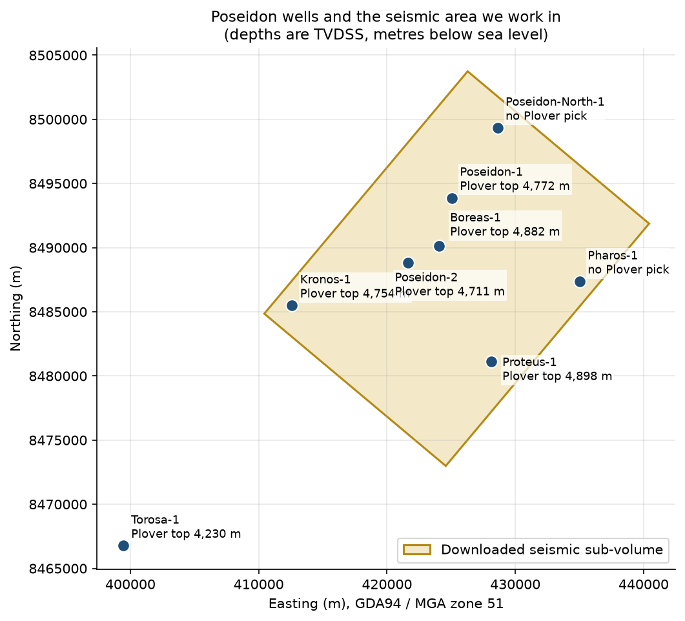

*Figure 3. Well locations, the depth of the Plover top in each well, and the seismic sub-volume we
downloaded (yellow). Torosa-1 is ~25 km away and outside the sub-volume.*

### 2.2 What data we have

| Data | What it is | Status |
|---|---|---|
| **Well logs** | Measurements down the borehole every 0.5 m: gamma ray, density, neutron, resistivity, P- and S-wave sonic | 8 wells (7 inside the seismic) |
| **Formation tops** | Depth where each formation starts in each well | Complete for Kronos-1, Poseidon-1, Poseidon-2, Torosa-1; reservoir top only for Boreas-1 and Proteus-1; **missing** for Pharos-1 and Poseidon-North-1 |
| **Time–depth** | Links depth (m) in the well to two-way time (ms) in the seismic | VSP-calibrated for Kronos-1 and Pharos-1; others still needed |
| **Seismic angle stacks** | Near, mid and far stacks: the same image built from small, medium and large reflection angles | Sub-volume downloaded: inlines 2310–3625, crosslines 1292–2769, 2560–4092 ms, ~3.4 GB per stack |

### 2.3 Reading a well log

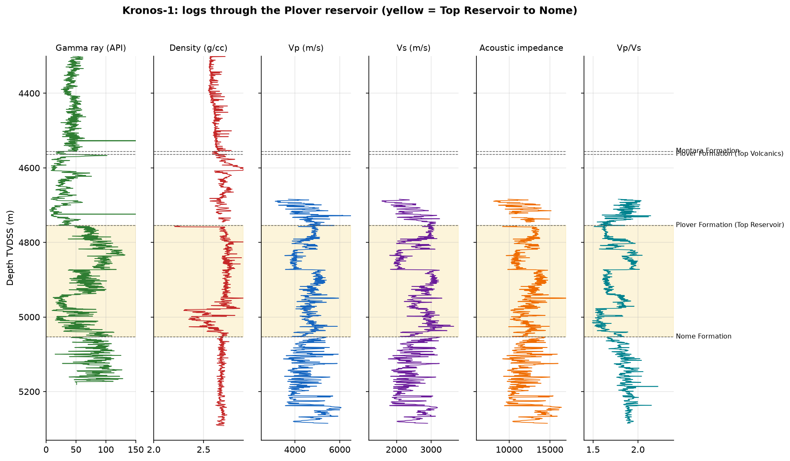

*Figure 4. Kronos-1 through the reservoir. The yellow band is the Plover reservoir (Top Reservoir to Nome).*

How to read it:

- **Gamma ray (GR)** measures natural radioactivity. Clay is radioactive, so *high GR = shale*, *low GR = clean
  sand*.
- **Density** is the bulk density of rock plus pore fluid. Porous rock and gas both *lower* density.
- **Vp** and **Vs** are the speeds of compressional (P) and shear (S) waves. They come from the sonic logs
  (slowness in µs/ft; Vp = 304 800 / DT).
- **Acoustic impedance (AI) = Vp × density.** This is what controls a seismic echo at normal incidence.
- **Vp/Vs** is very useful: shear waves do not travel through fluid, so gas lowers Vp but hardly changes Vs,
  and Vp/Vs drops.

Look at the lower part of the reservoir (around 4 980–5 020 m): low GR, low density, low AI and low Vp/Vs. That
is the classic signature of porous, gas-bearing sand.

---

## Chapter 3 – Rocks have elastic fingerprints

> **Key idea:** porosity, clay and fluid each push a rock's elastic properties in a different direction; if we
> can see those directions, we can separate rock type from fluid.

Every rock sample can be described by three numbers: Vp, Vs and density. Seismic only "feels" these three numbers,
so anything we want to predict (rock type, porosity, fluid) has to show up in them.

The most useful view is a **crossplot** of acoustic impedance against Vp/Vs:

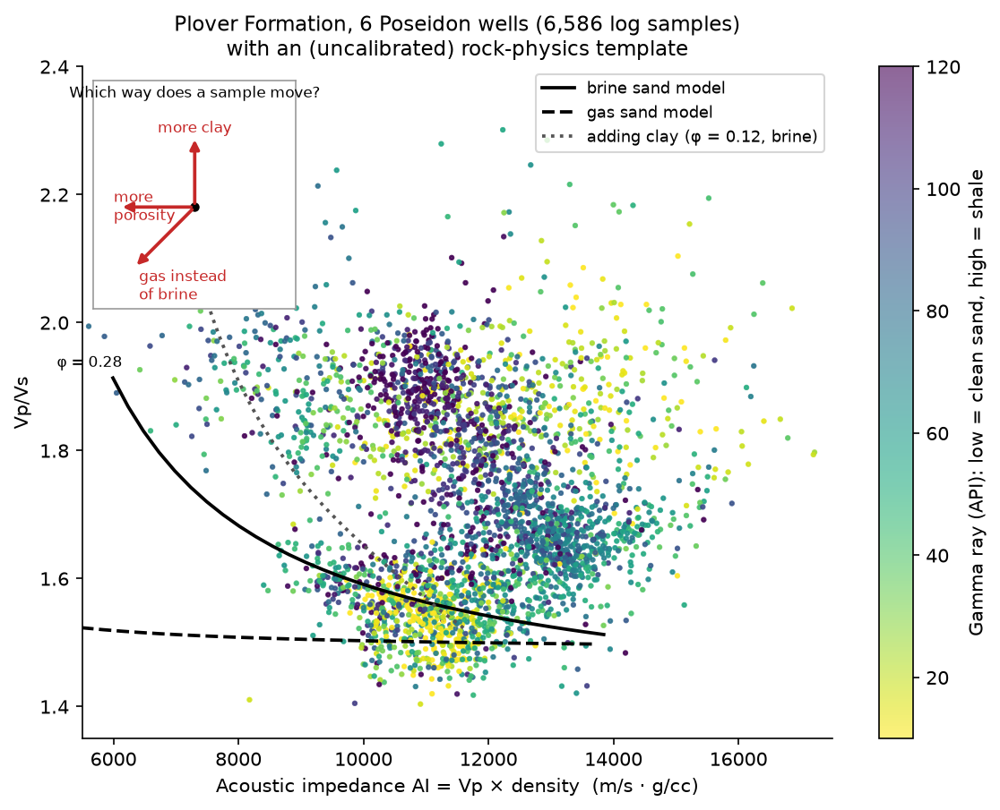

*Figure 5. All Plover log samples from six Poseidon wells, coloured by gamma ray. Black lines are a simple
**rock-physics model** (a "template"): solid = brine-filled clean sand with porosity increasing to the left,
dashed = the same sand with gas. The dotted line shows the effect of adding clay. The template is not yet
calibrated to Poseidon; it shows directions, not exact values.*

What to notice:

- **More porosity** moves a sample *left* (softer rock, lower AI).
- **More clay** moves it *up* (shales have high Vp/Vs).
- **Gas instead of brine** moves it *down and left*. Low AI and low Vp/Vs together are the best hydrocarbon
  indicator in this plot.
- The yellow (low-GR, clean) samples at Vp/Vs ≈ 1.45–1.6 sit close to the gas-sand line. That is encouraging
  for Poseidon.
- The clouds **overlap**. A slightly cemented gas sand can look like a porous brine sand. This overlap is the
  heart of the uncertainty problem and the reason we work with probabilities.

---

## Chapter 4 – Echoes and angles: what AVO is

> **Key idea:** how strongly a boundary reflects depends on the angle of the seismic ray, and that angle
> dependence carries information about Vs and fluid that a normal seismic image throws away.

### 4.1 Reflections

Seismic waves reflect wherever the elastic properties change, for example at the top of a reservoir sand below
a shale. The **reflection coefficient** R tells how much of the energy comes back. At zero angle (straight down
and up) it depends only on acoustic impedance:

$$R(0) = \frac{AI_2 - AI_1}{AI_2 + AI_1}$$

A soft sand below a hard shale gives a negative R (a "trough"); a hard (cemented) sand gives a positive R.

### 4.2 Amplitude versus angle (AVO)

When the ray hits the boundary at an angle θ, part of the energy converts to shear waves, and the amount
reflected changes with angle. That change depends on the contrast in Vs and density, which is exactly where the
fluid information is. This is **AVO: Amplitude Versus Offset (or angle)**.

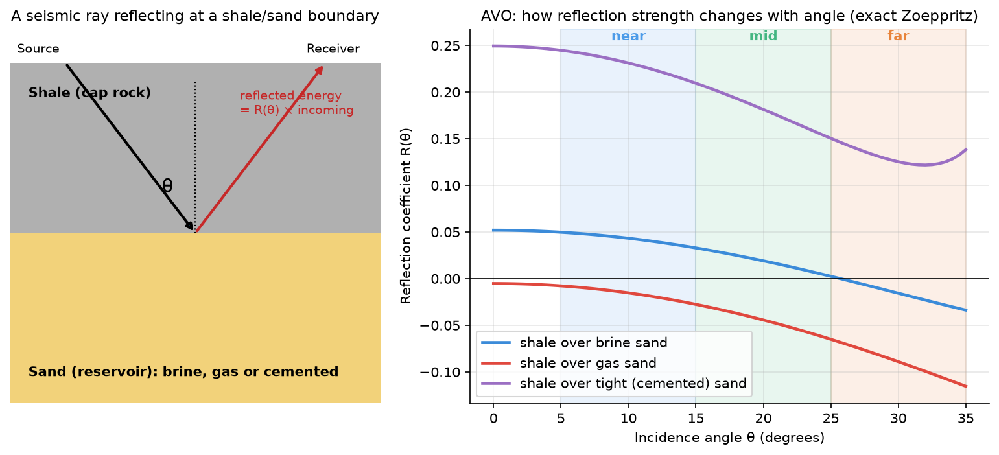

*Figure 6. Left: the geometry. Right: reflection coefficient against angle for a shale above three different
sands, computed with the exact Zoeppritz equations. The shaded bands are the angle ranges of the near, mid and
far stacks (5–15°, 15–25°, 25–35°; illustrative values, to be confirmed from the Poseidon processing report).*

Read the right panel like this:

- The **brine sand** starts weakly positive and decreases slowly.
- The **gas sand** starts near zero and becomes strongly negative at far angles. Its echo gets *brighter* with
  angle.
- The **tight sand** is strongly positive at all angles.

So the *difference* between near, mid and far stacks is the fingerprint. That is why we need all three stacks
and cannot just use a full stack.

### 4.3 Intercept and gradient

For angles up to about 30° the curve is close to a straight line in sin²θ (Shuey's approximation):

$$R(\theta) \approx I + G \sin^2\theta$$

- **Intercept I** is the reflection at zero angle (mostly AI contrast).
- **Gradient G** is how fast it changes with angle (mostly Vp/Vs and density contrast).

Plotting G against I gives the classic **AVO crossplot**:

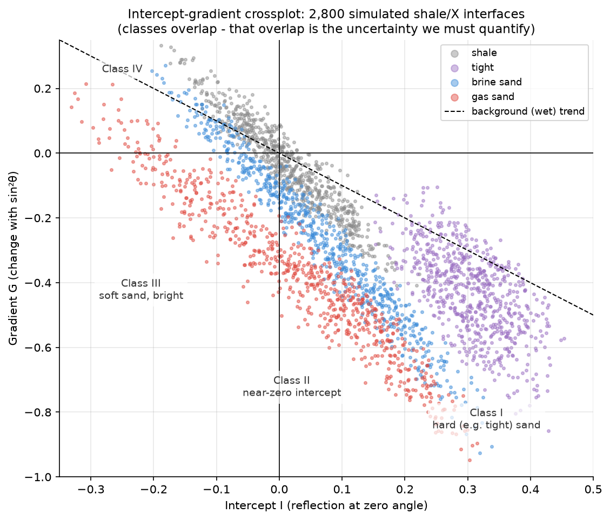

*Figure 7. 2,800 simulated interfaces (shale above shale, tight sand, brine sand or gas sand), including small
amounts of noise. Most non-reservoir interfaces fall along the dashed "background trend". Gas sands plot below and
left of it.*

The four AVO classes (I to IV) are names for regions of this plot. Our **baseline method A** classifies directly
in this plane. Again, notice the overlap between classes.

---

## Chapter 5 – Changing the fluid: Gassmann substitution

> **Key idea:** with Gassmann's equation we can take a real rock from a well and ask "what if this pore space
> held brine instead of gas?", which lets us create the cases the wells did not sample.

A well only tells us about the fluid it happened to find. To train a model that recognises both gas sand and
brine sand, we need examples of both, for the *same* rock. **Gassmann's equation** computes how the rock's
stiffness changes when the pore fluid changes, keeping the rock frame (the grains and their contacts) the same.

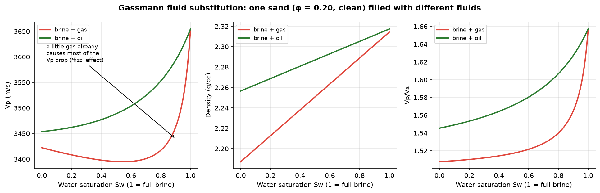

*Figure 8. One clean sand with 20% porosity, filled with different mixtures of brine and gas (red) or brine and
oil (green). Left: Vp. Middle: density. Right: Vp/Vs.*

Two important lessons:

1. **Gas has a much bigger effect than oil.** Gas is very compressible, so it softens the rock a lot. This is
   good news for Poseidon (gas) compared with the original Volve plan (heavy oil, weak effect).
2. **A little gas does most of the damage to Vp** (the "fizz-water" problem). A sand with only 10% gas can look
   almost like a commercial gas sand. Density, which falls steadily with gas saturation, helps separate them,
   but only if the far-angle data are good enough.

**Decision gate G3** formalises this: we push the brine and gas cases through the full forward model and ask
whether the difference in near/mid/far amplitudes is clearly larger than the noise. If not, we drop fluid as a
target and only predict rock type. That would be a valid result, not a failure.

---

## Chapter 6 – From logs to synthetic seismic: the well tie

> **Key idea:** if we can turn well logs into a synthetic seismic trace that matches the real seismic at the
> well, we have proven we understand the link between rocks and echoes.

A seismic trace can be modelled as the **reflectivity series** (one reflection coefficient at every boundary)
blurred by the **wavelet** (the shape of the seismic pulse):

$$\text{seismic trace} = \text{reflectivity} * \text{wavelet} + \text{noise}$$

To do this we need:

1. Vp, Vs and density from the logs (Chapter 3);
2. a **time–depth relation** to place each log sample at the right two-way time (from checkshots or a VSP);
3. reflectivity at the angles of each stack (Chapter 4);
4. a wavelet with the right frequency and phase, estimated from the real seismic around the well.

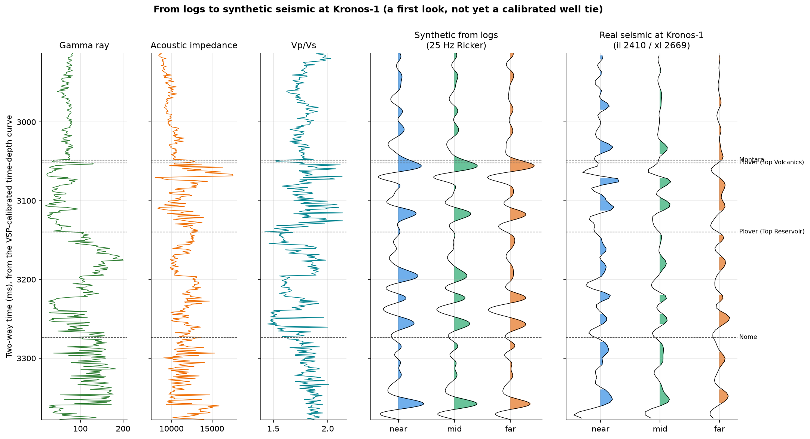

*Figure 9. Kronos-1. Left three tracks: logs converted to time with the VSP-calibrated time–depth curve.
Middle: synthetic near, mid and far traces using a simple 25 Hz Ricker wavelet. Right: the real near, mid and
far traces at the well. Some events already line up (e.g. around the top volcanics and the base of the
reservoir), others do not yet. This is a first look, not a calibrated tie.*

A tie is good when the main peaks and troughs line up in time, have similar character and show the same
near-to-far changes. **Decision gate G2** asks exactly this. If the tie is poor, nothing downstream can be
trusted, so we fix it first (time shift, wavelet, amplitude scaling).

What the real seismic looks like through Poseidon-1:

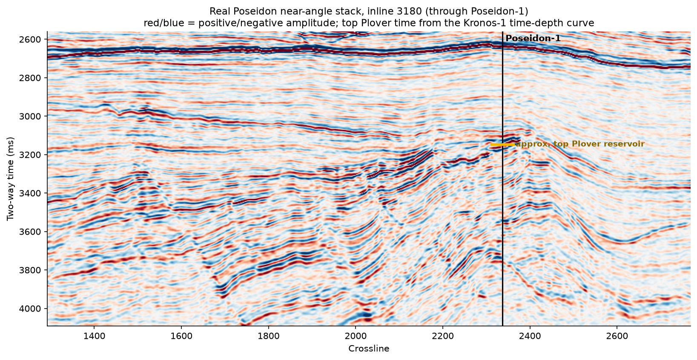

*Figure 10. Real near-angle stack through Poseidon-1. The yellow mark is the approximate time of the top Plover
reservoir, using the Kronos-1 time–depth curve (approximate until Poseidon-1 has its own tie).*

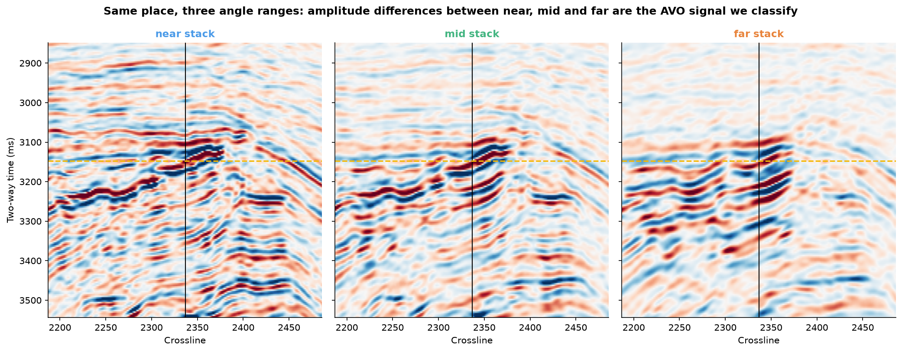

*Figure 11. The same zoomed area around Poseidon-1 in the near, mid and far stacks (yellow dashed line =
approximate top Plover). Look at how individual events change brightness, or even polarity, from near to far.
Those changes at the same event are the AVO signal we will classify. Note also that the far stack has lower
frequency (broader events), which the wavelet estimation must handle per stack.*

---

## Chapter 7 – Many possible earths: scenarios and Monte Carlo

> **Key idea:** seven wells are far too few examples to learn from, so we use physics to generate thousands of
> realistic "pseudo-wells" that cover the geology we expect, including cases no well has drilled.

### 7.1 Why simulate?

A classifier needs many labelled examples, with every class represented. We have seven wells, mostly in gas.
So we create **pseudo-wells**: artificial but physically consistent rock columns. For each one we draw random
values (this is **Monte Carlo** sampling) for:

- reservoir thickness and number of sand beds;
- porosity and clay content of each bed;
- thin cemented (tight) stringers;
- fluid (brine or hydrocarbon) and the depth of the fluid contact;
- rock-frame stiffness.

Each pseudo-well gets Vp, Vs and density from the rock-physics model, then synthetic near/mid/far seismic using
the wavelets from the well tie, plus realistic noise.

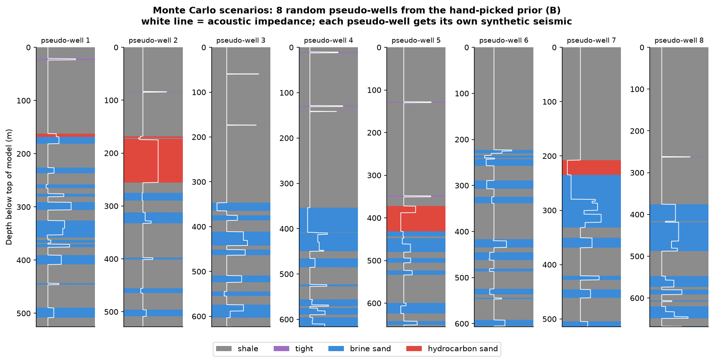

*Figure 12. Eight random pseudo-wells from the hand-picked prior. Grey = shale, purple = tight, blue = brine
sand, red = hydrocarbon sand. White = acoustic impedance. In the pipeline we generate hundreds to thousands
of these.*

### 7.2 Two ways to choose the scenarios: priors B and C

The rules for drawing random scenarios are called the **prior**. We compare two:

- **Prior B (hand-picked):** a geoscientist writes down ranges ("sand porosity between 8 and 30%", "reservoir 5
  to 100 m thick"). Easy to understand, but it is only as good as the ranges chosen.
- **Prior C (learned from wells):** cut the real training-well logs into blocks (overburden, reservoir,
  underburden), stretch and recombine them, and use Gassmann to swap fluids. The scenarios then look like the
  real geology, including its quirks.

### 7.3 What-if scenarios

The same machinery answers "what if" questions: what would the seismic look like if this sand had brine, or 5%
less porosity, or more clay?

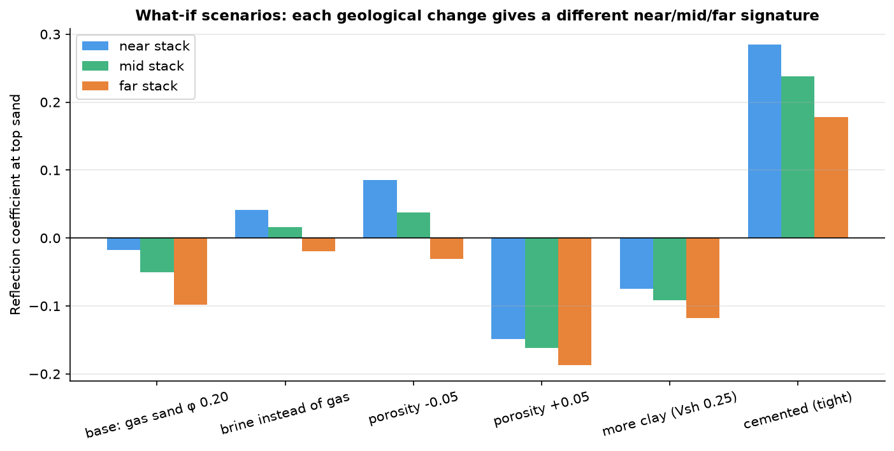

*Figure 13. Near, mid and far reflection coefficients at the top of a sand for different scenarios. Each
geological change has a different angle signature. This is why three stacks are better than one. Notice that
"brine instead of gas" and "porosity −0.05" can look similar on the near stack but differ on the far stack.*

The tool `python -m avo.whatif` applies such changes to a real well and shows the predicted response.

---

## Chapter 8 – Teaching a computer to recognise rock and fluid

> **Key idea:** we train a classifier on the simulated seismic (where we know the answer) and then apply it to
> the real seismic; the output is a probability for each class, not just a label.

### 8.1 The three methods we compare

| Method | What it uses | Trained on |
|---|---|---|
| **A: intercept–gradient** (baseline) | I and G at each sample | well data, simple classifier |
| **B: scenario-trained, hand-picked prior** | a short window of near/mid/far amplitudes around each sample | pseudo-wells from prior B |
| **C: scenario-trained, learned prior** | same as B | pseudo-wells from prior C |

Method A is the classical interpreter's approach. B and C are the new ideas. If B or C cannot beat A on blind
wells, we report that honestly (**decision gate G4**).

### 8.2 From features to probabilities

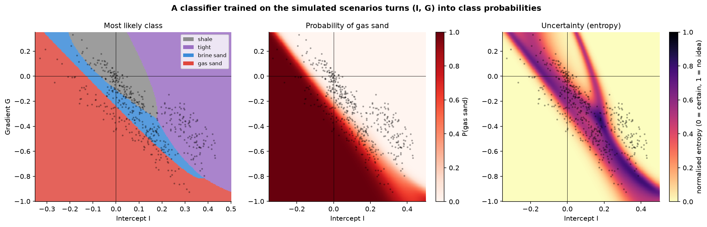

*Figure 14. A classifier trained on the simulated interfaces from Figure 7. Left: the most likely class at each
(I, G). Middle: probability of gas sand. Right: uncertainty (entropy). The uncertainty is high exactly where the
classes overlap.*

Methods B and C work the same way but use more information than just I and G: they look at the shape of the
near, mid and far traces over a short time window (about ±6 samples), using a gradient-boosting classifier.

### 8.3 The trap: synthetic is not real

A model trained on synthetic data can fail on real data if the synthetics are too clean or the wavelet is wrong.
We reduce this **domain gap** by:

- using wavelets and noise estimated from the real seismic at the training wells;
- adding random jitter to wavelet frequency, phase and amplitude scaling;
- flagging real seismic that looks unlike anything in the training library (**out-of-distribution** map, bottom
  right of Figure 2).

---

## Chapter 9 – Testing honestly: blind wells

> **Key idea:** a prediction is only worth something if it is right at wells the model has never seen.

### 9.1 The rule

Some wells are kept completely out of everything: the wavelet estimate, the prior, the training. They are used
**once, at the end**, to score the methods. Using them earlier, even "just to check", is called **data leakage**,
and it makes results look better than they are.

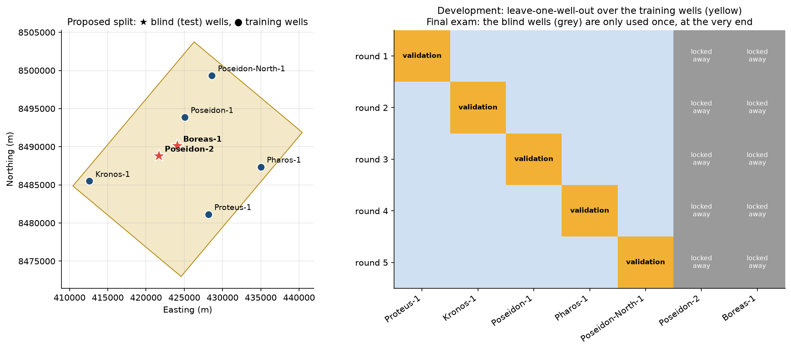

*Figure 15. Left: a proposed split with Poseidon-2 and Boreas-1 as blind wells. Right: during development we
use leave-one-well-out over the five training wells (each takes a turn as validation). The blind wells stay
locked away until the final test.*

Why Poseidon-2 and Boreas-1? Both have P-sonic, S-sonic and density across the Plover, a reservoir top, and lie
inside the seismic. Being central, they test *interpolation*. A tougher test of *extrapolation* would hold out an
edge well such as Poseidon-North-1. The team should agree the split before training starts and not change it
afterwards.

### 9.2 How we score

- **Balanced accuracy**: the share of correctly classified samples, averaged over classes so that a rare class
  (gas sand) counts as much as a common one (shale).
- **F1 score** per class: balances false alarms against misses.
- **Log loss**: punishes confident wrong answers. This is the metric that tests whether the probabilities can be
  trusted.

### 9.3 Are the probabilities honest?

If the model says "80% gas sand" at 100 places, about 80 of them should really be gas sand. A **reliability
diagram** checks this:

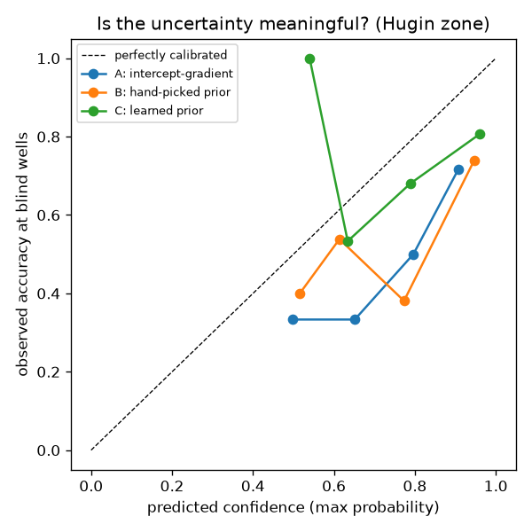

*Figure 16. Reliability diagram from the synthetic test. Points on the diagonal mean the probabilities are
honest; points below mean the model is over-confident.*

And this is what a blind-well comparison looks like:

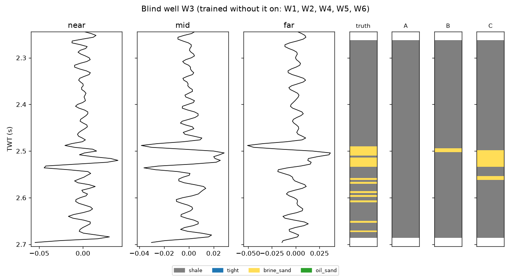

*Figure 17. Example blind-well panel from the synthetic test: true classes from logs, real and synthetic traces,
and predictions from A, B and C side by side.*

---

## Chapter 10 – Into 3D

> **Key idea:** once a method passes the blind-well test, we apply it to every seismic trace in a window around
> the reservoir horizon and write the results as cubes that load in any interpretation software.

Steps:

1. **Interpret the reservoir horizon** (top Plover) on the seismic. This defines the prediction window, e.g.
   60 ms above to 160 ms below the horizon. Outside the window, cubes contain a null value (−999.25).
2. **Predict** every sample in the window with the trained model (in batches, because the cube is large).
3. **Export** SEG-Y cubes with exactly the same geometry as the input stacks:

| Cube | Meaning |
|---|---|
| `P(shale)`, `P(tight)`, `P(sand)` | Lithology probabilities (sum to 1) |
| `P(brine given sand)`, `P(gas given sand)` | Fluid probabilities, only where P(sand) ≥ 0.5 and only if gate G3 passed |
| `most_likely_class` | 0 shale, 1 tight, 2 brine sand, 3 hydrocarbon sand |
| `uncertainty_entropy` | 0 = certain, 1 = completely uncertain |

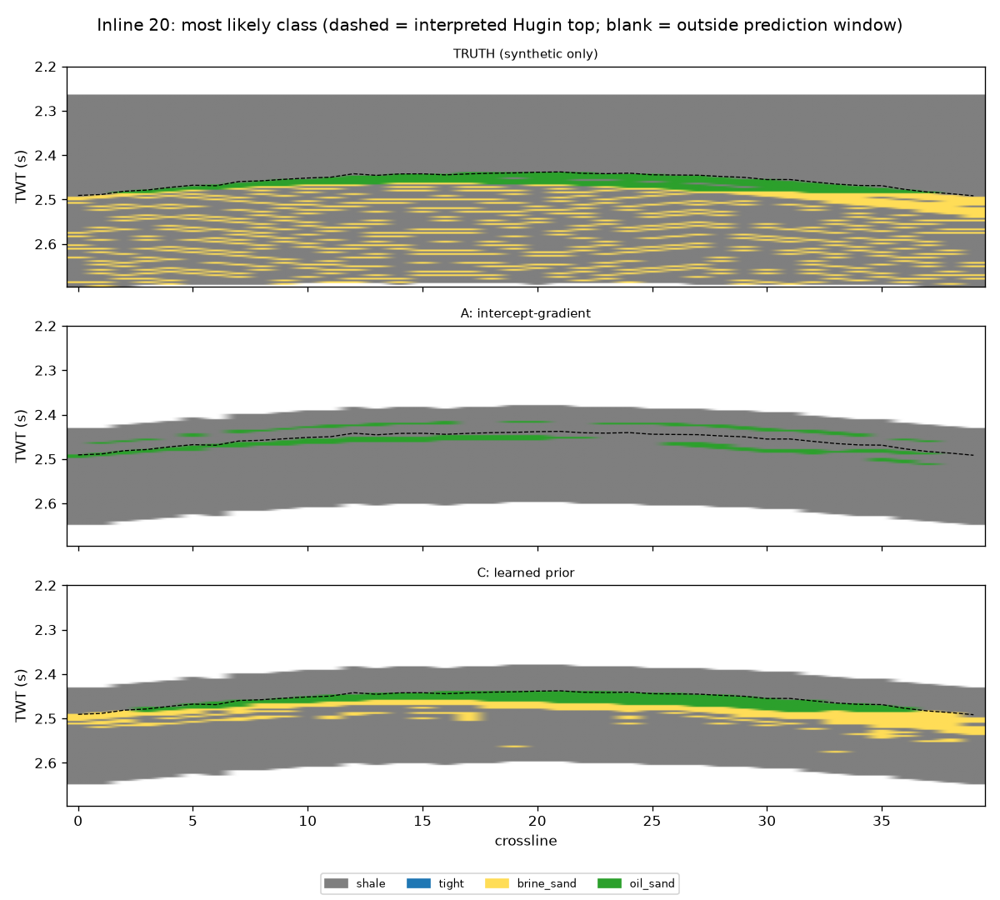

*Figure 18. Example vertical section through the probability cubes (synthetic test).*

---

## Chapter 11 – Understanding uncertainty

> **Key idea:** the uncertainty is not a weakness of the result; it *is* part of the result, and it tells you
> where more data would help most.

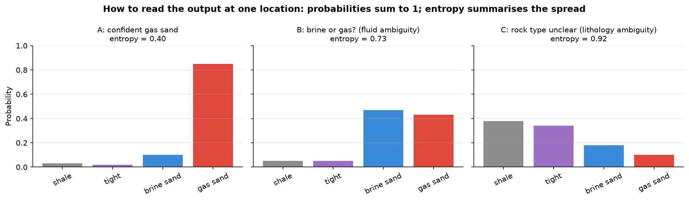

*Figure 19. Three example locations. A is a confident gas sand. B is clearly sand, but brine vs gas is a coin
toss: a **fluid ambiguity**. C is unclear about the rock type itself: a **lithology ambiguity**.*

**Entropy** summarises the spread in one number (0 = one class has all the probability, 1 = all classes equal).
But always look at *which* classes share the probability. Situation B and situation C need different actions:

- Fluid ambiguity (B): better far-angle data, a pressure/fluid study, or a different fluid indicator may help.
- Lithology ambiguity (C): better porosity/cement understanding, more wells, or thin beds below seismic
  resolution may be the cause.

Other reasons to distrust a prediction:

- **Out-of-distribution areas**: the seismic looks unlike the training library (e.g. faults, volcanics,
  noise).
- **Thin beds**: layers thinner than about a quarter of the wavelength (~15–25 m here) cannot be resolved
  individually; the model will see an average.
- **Poor tie**: if the well tie is uncertain, so is everything.

### Running multiple scenarios

Because the probabilities depend on the prior, we run the whole workflow for several scenario sets, for example
different porosity ranges, gas saturations or rock-frame models, and compare the resulting maps. Where all
scenarios agree, the prediction is robust. Where they disagree, the answer depends on assumptions we cannot yet
test, and that is important for decision makers to know.

---

## Chapter 12 – Decision gates and where Poseidon stands

The project uses four go/no-go checkpoints so that we do not build on a weak foundation:

| Gate | Question | If "no" |
|---|---|---|
| **G1 Data** | Near/mid/far stacks and ≥3 wells with Vp, density, Vs (or a defensible estimate) and time–depth? | Reduce scope; flag estimated Vs |
| **G2 Tie** | Do synthetics match the real seismic at the tie wells in timing, frequency and character? | Fix tie/wavelet/scaling before modelling |
| **G3 Fluid** | Is the brine-vs-gas difference in near/mid/far larger than noise and rock variability? | Drop fluid; predict rock type only |
| **G4 Value** | Do methods B or C beat baseline A at the blind wells? | Report the negative result honestly |

**Status for Poseidon (19 November 2026):**

- G1 is essentially met: three stacks downloaded, seven wells with P-sonic, S-sonic and density in the Plover.
  Time–depth is still limited to Kronos-1 and Pharos-1 (VSP), so the others need a tie.
- G2, G3 and G4 have only been run on the synthetic test case so far (all passed there, but that test is
  partly circular, see the warning in the synthetic report).

---

## Chapter 13 – Hands-on: the tools

### Getting the data

```powershell
.\.venv\Scripts\python.exe -m pip install -r requirements.txt
.\.venv\Scripts\python.exe scripts\download_poseidon_wells.py      # logs, tops, headers (~30 MB)
.\.venv\Scripts\python.exe scripts\download_poseidon_seismic.py    # near/mid/far sub-volume (~10 GB)
.\.venv\Scripts\python.exe scripts\prepare_poseidon_dashboard.py   # combine wells for the dashboard
```

### The dashboard

```powershell
.\.venv\Scripts\streamlit.exe run dashboard\app.py
```

- **Well logs**: pick a well and depth range; formation tops are drawn on the tracks.
- **Field overview**: well map coloured by the depth of a chosen surface, and a tops correlation panel.
- **Rock-property crossplots**: density vs sonic, GR vs resistivity, and AI vs Vp/Vs (Figure 5) for one
  well or all wells, filtered by formation.
- **Data preview**: the numbers behind the plots and the provenance of the data.

### The pipeline

```powershell
.\.venv\Scripts\python.exe -m avo.run_synthetic --quick     # full workflow on the synthetic test (~10 s)
.\.venv\Scripts\python.exe -m avo.whatif --well W5 --fluid brine
.\.venv\Scripts\python.exe -m pytest -q
```

---

## Chapter 14 – Open issues and next steps for Poseidon

1. **Switch the fluid model from oil to gas.** `configs/pipeline.yaml` still describes Volve Hugin oil. Poseidon
   needs gas (or gas-condensate) properties at Plover pressure and temperature.
2. **Pick tops for Pharos-1 and Poseidon-North-1**, using Kronos-1 and Poseidon-1 as type wells, or get them
   from the well completion reports when Google Drive allows downloads.
3. **Time–depth for all wells.** Tie each training well (Chapter 6), starting from the Kronos-1 and Pharos-1 VSP
   curves.
4. **Confirm the stack angle ranges** from the Poseidon processing report (we used 5–15°, 15–25°, 25–35°).
5. **Interpret the top Plover horizon** in the seismic sub-volume; it defines the 3D prediction window.
6. **Agree the blind-well split** and record it in `outputs/decision_log.md` before training.
7. **Define the lithotype classes** for Poseidon, e.g. shale, tight, low-porosity sand, high-porosity sand, with
   cut-offs agreed from the logs.

---

## Glossary

- **Acoustic impedance (AI)**: Vp × density. Controls the normal-incidence reflection.
- **Angle stack (near/mid/far)**: seismic image built only from reflections within a range of incidence angles.
- **AVO**: amplitude versus offset/angle; the change of reflection strength with angle.
- **Balanced accuracy**: accuracy averaged over classes, so rare classes count equally.
- **Blind well**: a well excluded from all calibration and training, used only for final testing.
- **Data leakage**: information from the test data sneaking into training, making results look too good.
- **Domain gap**: differences between synthetic training data and real data that can mislead a model.
- **Entropy (normalised)**: 0 when one class has all the probability, 1 when all classes are equally likely.
- **Formation top**: the depth in a well where a named formation begins.
- **Gassmann's equation**: predicts how rock stiffness changes when the pore fluid changes.
- **Gradient (G)**: how fast reflectivity changes with sin²θ.
- **Intercept (I)**: reflectivity at zero angle.
- **Lithotype / lithology**: rock type (shale, sand, tight/cemented rock, ...).
- **Monte Carlo**: generating many random but plausible cases to explore uncertainty.
- **Out-of-distribution (OOD)**: input data unlike anything the model was trained on.
- **Prior**: the rules and ranges used to generate scenarios; what we believe before looking at the seismic.
- **Probability cube**: a 3D seismic-format volume where each sample holds a probability.
- **Pseudo-well**: a simulated, physically consistent rock column used for training.
- **Reflection coefficient (R)**: fraction of wave amplitude reflected at a boundary.
- **Reliability diagram**: plot of predicted probability against observed frequency; checks if probabilities are
  honest.
- **Rock-physics model / template**: equations linking porosity, minerals and fluid to Vp, Vs and density.
- **TVDSS**: true vertical depth below sea level.
- **TWT**: two-way travel time (ms), the vertical axis of seismic.
- **Vp, Vs**: compressional and shear wave velocities.
- **Vp/Vs**: velocity ratio; sensitive to fluid and clay.
- **VSP / checkshot**: borehole measurements that give the time–depth relation.
- **Wavelet**: the shape of the seismic pulse; blurs the reflectivity into the seismic trace.
- **Well tie**: matching a synthetic seismogram from logs to the real seismic at the well.

## Further reading

- Avseth, Mukerji and Mavko (2005), *Quantitative Seismic Interpretation*. Cambridge University Press.
- Simm and Bacon (2014), *Seismic Amplitude: An Interpreter's Handbook*. Cambridge University Press.
- Mavko, Mukerji and Dvorkin (2009), *The Rock Physics Handbook*, 2nd ed. Cambridge University Press.
- Batzle and Wang (1992), Seismic properties of pore fluids. *Geophysics* 57, 1396–1408.
- Shuey (1985), A simplification of the Zoeppritz equations. *Geophysics* 50, 609–614.
- Rutherford and Williams (1989), Amplitude-versus-offset variations in gas sands. *Geophysics* 54, 680–688.
- Project documents: [constitution.md](../../constitution.md), [agents/README.md](../../agents/README.md) and
  the synthetic test report `outputs/synthetic/report.md`.
