# AVO lithology/fluid workflow: synthetic concept test

**Question:** do well-anchored simulations predict Hugin lithology and fluid from near/mid/far stacks, and does a geology prior learned from wells (C) beat hand-picked Monte Carlo ranges (B) and a classical intercept-gradient interpretation (A) at blind wells?

> **This is a synthetic test of the workflow, not a geological result.** The 'earth', wells and seismic were generated by `avo.synthetic_earth`. Prior C learns from wells drawn from the same synthetic earth, so its advantage is partly built in. The purpose is to verify that every step runs, that there is no leakage, and that the evaluation would detect a method that does not work.

## Decision gates

- **G1: PASS.** 6 wells (5 with measured Vs), 3 partial stacks
- **G2: PASS.** mean tie correlation per stack: far=0.87, mid=0.84, near=0.80
- **G3: PASS.** median (over wells) of best-stack brine-vs-oil difference / noise = 3.43 (threshold 1.0). Fluid kept as a target.
- **G4: PASS.** mean Hugin-zone balanced accuracy at blind wells: A=0.51, B=0.54, C=0.69 (n_wells=6)

Classes: shale, tight, brine_sand, oil_sand. Estimated wavelets: near: 27 Hz / 0 deg, mid: 24 Hz / 0 deg, far: 22 Hz / 0 deg.

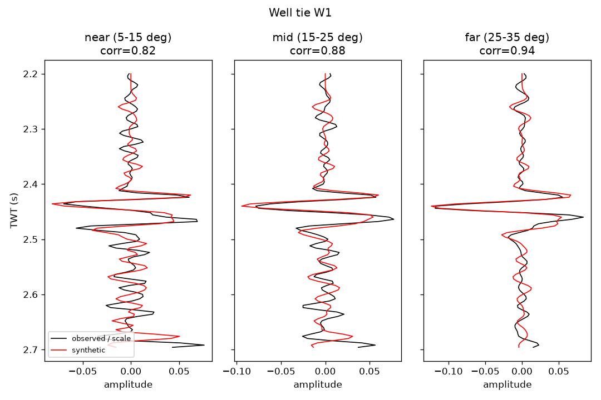

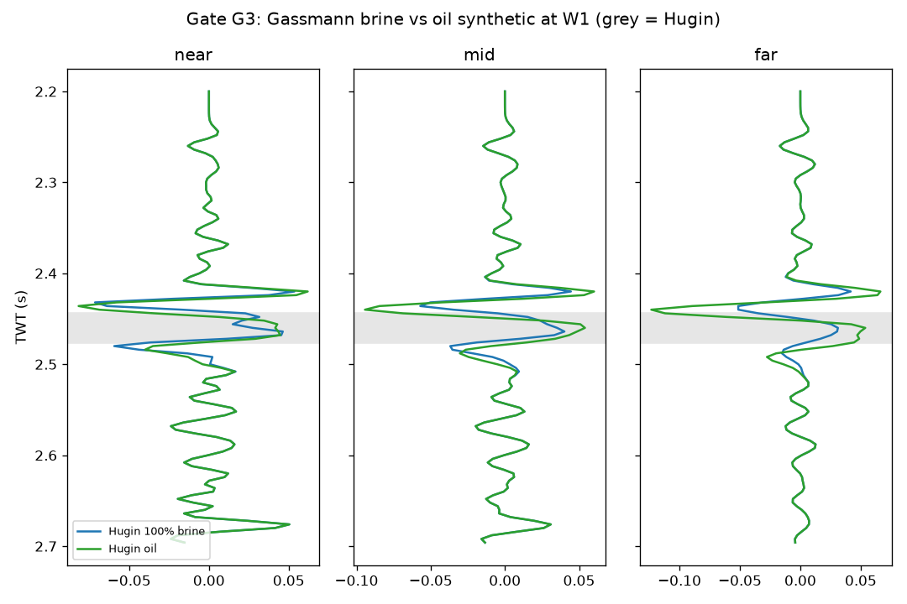

## Blind-well validation (leave-one-well-out, Hugin zone)

Calibration, prior C and all models were refit without the blind well each time. n = 6 wells: an indication, not statistical proof.

| method | balanced_acc | macro_f1 | log_loss | oil_sand_f1 |
|---|---|---|---|---|
| A: intercept-gradient | 0.509 | 0.429 | 1.374 | 0.438 |
| B: hand-picked prior | 0.540 | 0.530 | 1.075 | 0.336 |
| C: learned prior | 0.691 | 0.683 | 0.781 | 0.476 |

Balanced accuracy per blind well:

| blind_well | A | B | C |
|---|---|---|---|
| W1 | 0.417 | 0.458 | 0.625 |
| W2 | 0.583 | 0.222 | 0.426 |
| W3 | 0.500 | 0.600 | 0.850 |
| W4 | 0.500 | 0.750 | 0.833 |
| W5 | 0.556 | 0.458 | 0.597 |
| W6 | 0.500 | 0.750 | 0.812 |

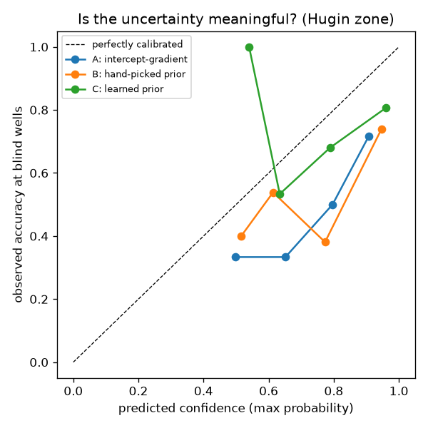

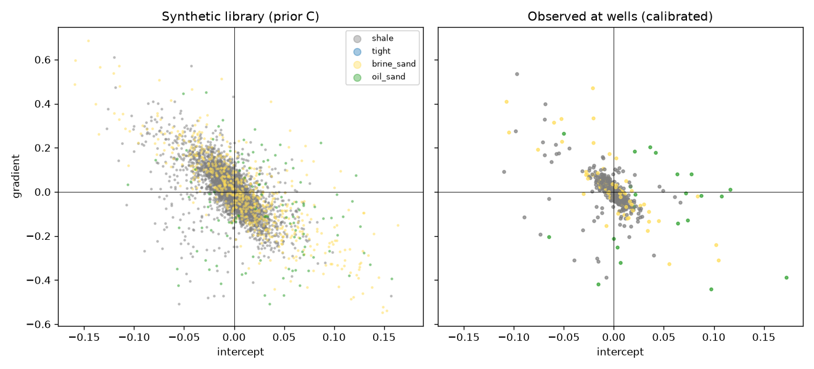

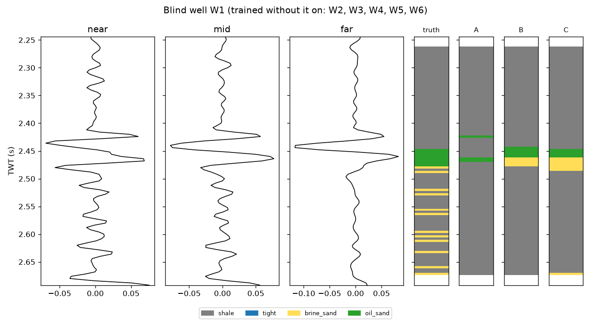
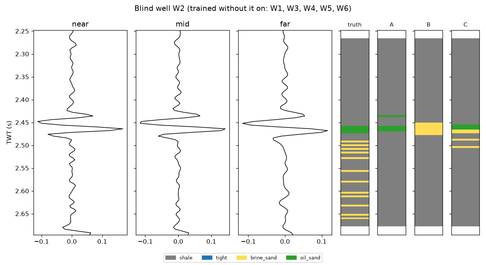
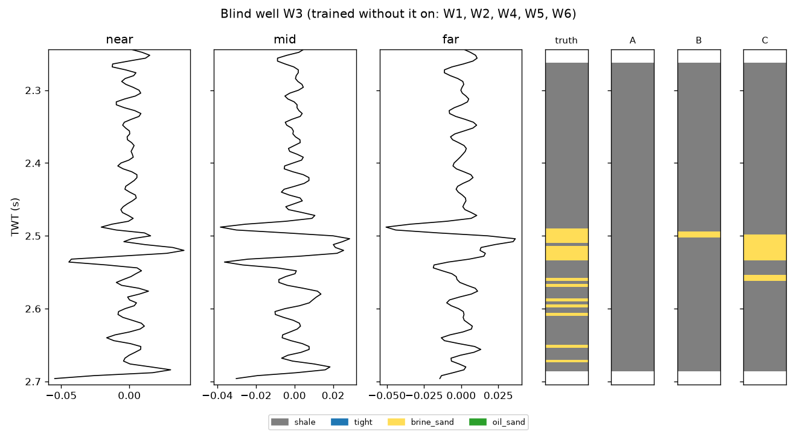
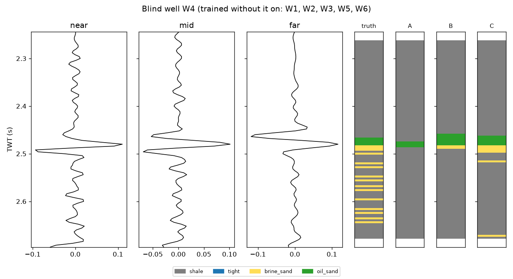
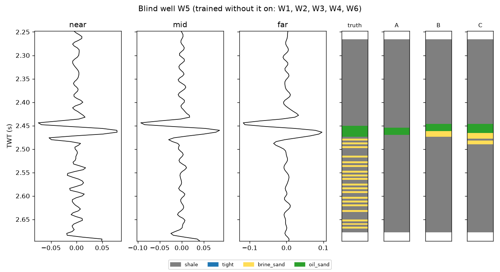
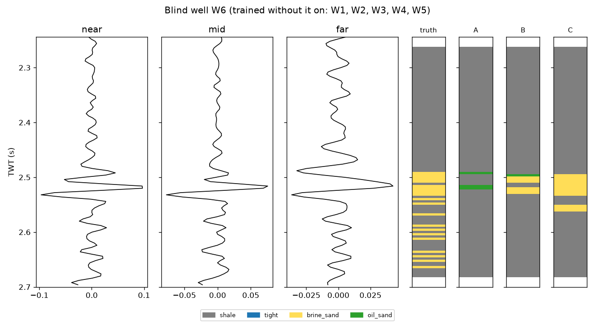

## Maps

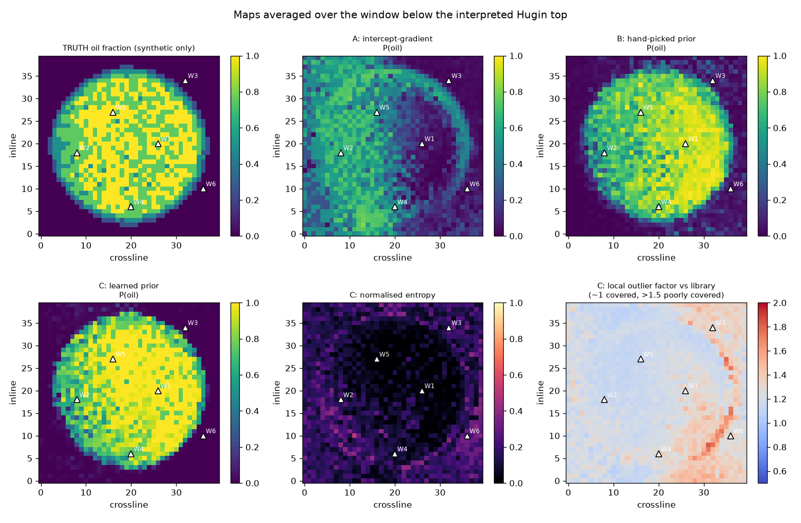

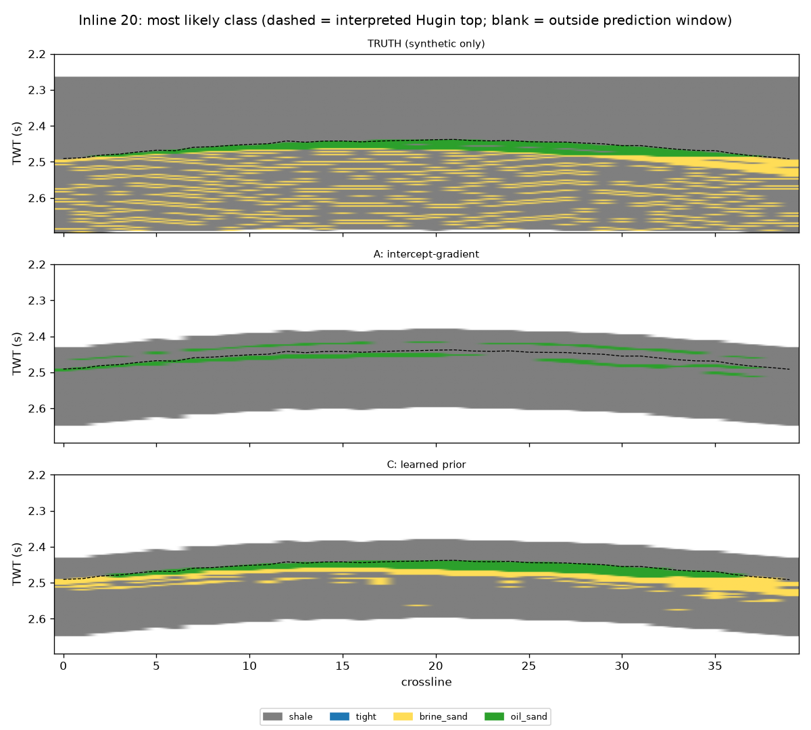

Scores against the known synthetic truth in the map window (all traces):

| method | n | balanced_acc | macro_f1 | log_loss | oil_sand_f1 |
|---|---|---|---|---|---|
| A: intercept-gradient | 6400 | 0.430 | 0.278 | 2.488 | 0.512 |
| B: hand-picked prior | 6400 | 0.651 | 0.653 | 0.728 | 0.848 |
| C: learned prior | 6400 | 0.724 | 0.736 | 0.546 | 0.905 |

## Limitations

- Only 6 wells; wells in the same structure are not independent.
- Vs estimated (Greenberg-Castagna) in: W4.
- Wavelets are Ricker-family estimates; partial stacks are modelled as angle-averaged Aki-Richards.
- Probabilities are conditional on the priors; see the reliability plot before trusting them.
- Thin beds below seismic resolution (e.g. calcite stringers) cannot be predicted as separate classes.
- Synthetic test only; seismic/log timing relative to production is not modelled.
